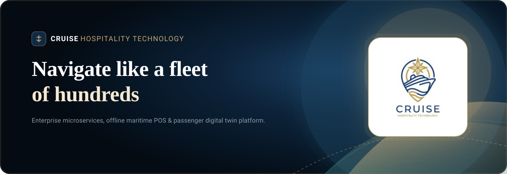
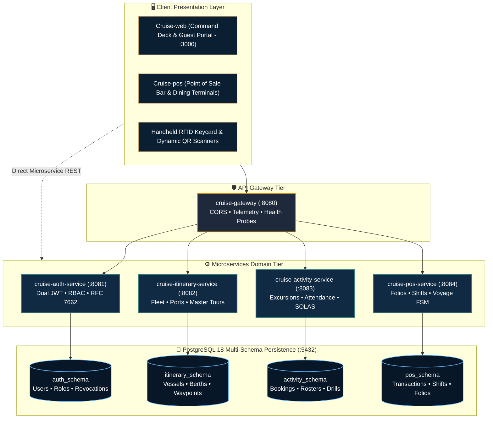
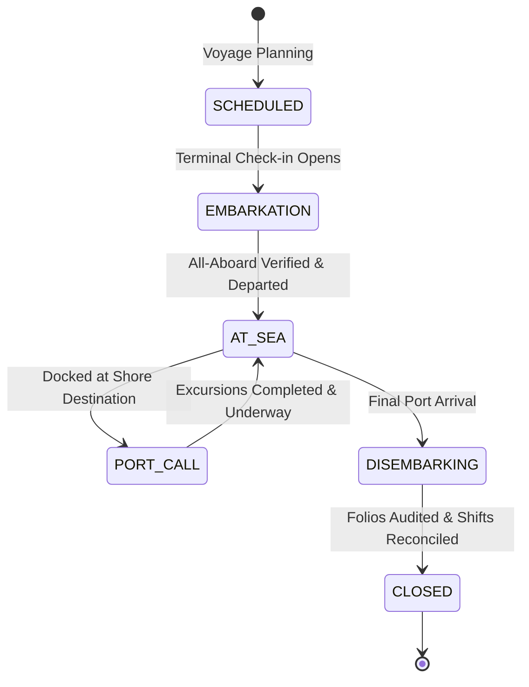

<div align="center">



<br />

# 🚢 CRUISE-API
### Enterprise Maritime Microservices Platform & Fleet Telemetry Engine

**An open-standard, distributed backend ecosystem engineered for luxury cruise fleet operations.**  
Orchestrating mission-critical nautical compliance, SOLAS Chapter III real-time muster telemetry, distributed multi-schema PostgreSQL persistence, dynamic cryptographic QR access control, and offline-tolerant POS retail accounting.

<br />

<p align="center">
  <a href="https://www.oracle.com/java/">
    
  </a>
  <a href="https://spring.io/projects/spring-boot">
    
  </a>
  <a href="https://www.postgresql.org/">
    
  </a>
  <a href="https://www.docker.com/">
    
  </a>
  <a href="https://www.postman.com/">
    
  </a>
  <a href="https://sonarcloud.io/project/overview?id=Cruise-JavaCLass_Cruise-api">
    
  </a>
  <a href="./LICENSE">
    
  </a>
</p>

</div>

---

<details>
<summary><b>📑 Table of Contents (Click to explore)</b></summary>

- [1. Executive Architectural Overview](#executive-architectural-overview)
- [2. Microservices Topology & Bounded Contexts](#microservices-topology--bounded-contexts)
- [3. System Architecture & Topology Diagram](#system-architecture--topology-diagram)
- [4. Mission-Critical Maritime Specifications](#mission-critical-maritime-specifications)
- [5. One-Click Developer Orchestration](#one-click-developer-orchestration)
- [6. Automated Postman Enterprise Test Suite](#automated-postman-enterprise-test-suite)
- [7. Complete REST API Matrix (37 Endpoints)](#complete-rest-api-matrix-37-endpoints)
- [8. Quality Assurance, SonarCloud & CI/CD](#quality-assurance-sonarcloud--cicd)
- [9. Governance & License](#governance--license)

</details>

---

<a id="executive-architectural-overview"></a>
## 🏛️ 1. Executive Architectural Overview

`Cruise-api` serves as the centralized computational backbone for the **Grand Pearl Voyager** luxury cruise management fleet. Engineered with Spring Boot and Java 21, the system decouples complex maritime logistics into **5 autonomous, loosely coupled microservices** bound together by standardized REST contracts and isolated database schemas.

> [!NOTE]
> **Maritime Reliability Standard:** Designed to operate smoothly during deep-sea oceanic transits where satellite uplink latency varies from 20ms to high-jitter disconnected states, ensuring offline resilience and strict operational integrity.

---

## 🧩 2. Microservices Topology & Bounded Contexts

Each bounded context maintains absolute domain autonomy, backed by its dedicated PostgreSQL database schema to enforce transactional isolation.

<table>
  <thead>
    <tr>
      <th width="24%">Microservice</th>
      <th width="10%">Port</th>
      <th width="18%">Schema Isolation</th>
      <th width="48%">Core Capabilities & Nautical Responsibilities</th>
    </tr>
  </thead>
  <tbody>
    <tr>
      <td><b><code>cruise-gateway</code></b><br/><i>Gateway Entrypoint</i></td>
      <td><code>8080</code></td>
      <td><i>Stateless (None)</i></td>
      <td>
        • Central API reverse proxy & health telemetry coordinator.<br/>
        • Unified sub-millisecond heartbeat probes (<code>/ping</code>, <code>/info</code>, <code>/health</code>).<br/>
        • Cross-Origin Resource Sharing (CORS) security enforcement.
      </td>
    </tr>
    <tr>
      <td><b><code>cruise-auth-service</code></b><br/><i>Identity & Access</i></td>
      <td><code>8081</code></td>
      <td><code>auth_schema</code></td>
      <td>
        • Dual-token authentication (HMAC-SHA256 JWT Access + Rotating Refresh Token).<br/>
        • Role-Based Access Control (RBAC) across 8 nautical ranks.<br/>
        • RFC 7662 Token Introspection & instant blacklist revocation.
      </td>
    </tr>
    <tr>
      <td><b><code>cruise-itinerary-service</code></b><br/><i>Fleet & Navigation</i></td>
      <td><code>8082</code></td>
      <td><code>itinerary_schema</code></td>
      <td>
        • Vessel master registry (tonnage, dimensions, stateroom tiers, decks).<br/>
        • Global port of call catalog & docking berth coordination.<br/>
        • Master sailing itineraries, waypoint scheduling & maritime cabotage policies.
      </td>
    </tr>
    <tr>
      <td><b><code>cruise-activity-service</code></b><br/><i>Excursions & Safety</i></td>
      <td><code>8083</code></td>
      <td><code>activity_schema</code></td>
      <td>
        • Gala dinners, Broadway theatricals & wellness scheduling.<br/>
        • Shore excursions (capacity locking, pricing, bus dispatching, guide rosters).<br/>
        • <b>SOLAS Compliance:</b> All-Aboard departure countdown & Muster drills.<br/>
        • Cryptographic dynamic QR pass generation (60s TTL).
      </td>
    </tr>
    <tr>
      <td><b><code>cruise-pos-service</code></b><br/><i>Retail, Folio & Billing</i></td>
      <td><code>8084</code></td>
      <td><code>pos_schema</code></td>
      <td>
        • Onboard retail catalogs (dining, bars, spa, boutiques).<br/>
        • Cashier shift lifecycle, safe cash drops & mid-day X-Reports.<br/>
        • Passenger stateroom folio accounting, cabin charging & disputes.<br/>
        • <b>Voyage State Machine:</b> Transactional phase locking.
      </td>
    </tr>
    <tr>
      <td><b><code>cruise-common</code></b><br/><i>Shared Core Library</i></td>
      <td><i>Library</i></td>
      <td><i>N/A</i></td>
      <td>
        • Universal response projections (<code>ApiResponse&lt;T&gt;</code>, pagination metadata).<br/>
        • Global error codes, security annotations & domain enumerations.
      </td>
    </tr>
  </tbody>
</table>

---

## 📐 3. System Architecture & Topology Diagram



---

<a id="mission-critical-maritime-specifications"></a>
## ⚓ 4. Mission-Critical Maritime Specifications

### A. SOLAS Chapter III Regulation 19 Compliance
In accordance with the **International Convention for the Safety of Life at Sea (SOLAS)**:
- **Mandatory Muster Station Drills:** `SolasMusterEmergencyController` enforces compulsory digital verification of guest emergency stations before any vessel unmoors from port.
- **All-Aboard Watchdog:** `AllAboardWatchdogController` maintains a real-time countdown sync between shore excursion attendance rosters and ship departure schedules to eliminate abandoned passengers.

### B. High-Security Dynamic QR Passes
- Issued through `QrTokenService` utilizing an HMAC-SHA256 signature with an ephemeral **60-second Time-To-Live (TTL)**. The signing key is supplied via the `CRUISE_QR_SECRET` environment variable (with local test fallback restricted to the `dev` profile).
- The 60-second TTL limits the replay window, mitigating ticket scalping and unauthorized access to VIP lounges or high-capacity tender boats.

### C. Voyage Global Lifecycle Finite State Machine
Every voyage adheres to a strict, transactional sequence enforced across all endpoints:



---

<a id="one-click-developer-orchestration"></a>
## ⚡ 5. One-Click Developer Orchestration

### Prerequisites
- **JDK 21 LTS** (`java -version` returns Java 21)
- **Docker Desktop** running (for PostgreSQL 18)
- **Node.js & npm** (Node.js 18+ for running Newman CLI via `npx newman`)
- **Postman Desktop** (for visual test execution)

### 🚀 1-Click Launch (Recommended)
You can launch the entire infrastructure in seconds using the idempotent root scripts:

```cmd
:: 1. Package all microservices (required on clean checkout)
.\mvnw.cmd clean package -DskipTests

:: 2. Launch PostgreSQL and all 5 Microservices in dedicated, titled consoles
run-all-services.bat

:: Stop all running microservices and release ports cleanly
stop-all-services.bat
```

> [!TIP]
> **Idempotent Automation:** `run-all-services.bat` automatically terminates any stale processes lingering on ports `8080-8084`, validates that all packaged JARs exist in `target/`, waits for the Docker PostgreSQL container to become healthy via `docker compose up -d --wait`, ensures `CRUISE_QR_SECRET` is set, and spins up all 5 microservices cleanly.

---

### Manual Terminal Execution
```bash
# 1. Start the PostgreSQL 18 container with pre-configured schemas
docker compose up -d

# 2. Build and install common DTOs and contracts
./mvnw -pl cruise-common install -DskipTests

# 3. Launch individual services as needed
./mvnw -pl cruise-gateway spring-boot:run            # Port 8080
./mvnw -pl cruise-auth-service spring-boot:run       # Port 8081
./mvnw -pl cruise-itinerary-service spring-boot:run  # Port 8082
./mvnw -pl cruise-activity-service spring-boot:run   # Port 8083
./mvnw -pl cruise-pos-service spring-boot:run        # Port 8084
```

---

<a id="automated-postman-enterprise-test-suite"></a>
## 📬 6. Automated Postman Enterprise Test Suite

The project includes an enterprise-grade automated Postman test suite located in [`docs/postman/`](./docs/postman/):

- 📦 **Collection:** [`Cruise_Management_System_v1.0.0.postman_collection.json`](./docs/postman/Cruise_Management_System_v1.0.0.postman_collection.json)
- 🌐 **Environment:** [`Cruise_Local.postman_environment.json`](./docs/postman/Cruise_Local.postman_environment.json)

### Pre-Configured Environment Variables:

| Variable | Value | Description |
|---|---|---|
| `baseUrl` | `http://localhost:8080/api` | Gateway Unified API Base URL |
| `gatewayUrl` | `http://localhost:8080` | Gateway Root Service URL |
| `authUrl` | `http://localhost:8081` | Authentication Microservice URL |
| `itineraryUrl` | `http://localhost:8082` | Itinerary & Fleet Microservice URL |
| `activityUrl` | `http://localhost:8083` | Activity & SOLAS Microservice URL |
| `posUrl` | `http://localhost:8084` | POS & Folio Microservice URL |
| `jwt_token` | *(Dynamic)* | Auto-populated by Admin Login request |
| `admin_username`| `admin` | Default Maritime Admin identifier |
| `admin_password`| `admin123` | Default Maritime Admin credential |

### Automated Execution via Newman CLI:
```bash
# Run the entire 37-endpoint suite with terminal summary table
npx --yes newman run docs/postman/Cruise_Management_System_v1.0.0.postman_collection.json \
  -e docs/postman/Cruise_Local.postman_environment.json \
  --reporters cli
```

---

## 📋 7. Complete REST API Matrix (37 Endpoints)

<details open>
<summary><b>00 - Gateway & System Monitoring (Port 8080)</b></summary>

| Method | Endpoint | Description |
|:---:|---|---|
| `GET` | `/api/ping` | Gateway high-speed heartbeat check (`pong`) |
| `GET` | `/api/info` | Application specifications, runtime JVM and build version |
| `GET` | `/api/health` | Memory allocation (used/free), uptime and status |

</details>

<details open>
<summary><b>01 - Authentication & User Security (Port 8081)</b></summary>

| Method | Endpoint | Description |
|:---:|---|---|
| `GET` | `/api/auth/health` | Auth microservice readiness probe and supported roles |
| `POST` | `/api/auth/login` | Authenticate crew member & **auto-capture JWT Bearer token** |
| `GET` | `/api/auth/me` | Retrieve profile and assigned rank of authenticated user |
| `POST` | `/api/auth/verify-token` | Token Introspection (RFC 7662) and cryptographic verification |
| `POST` | `/api/auth/refresh` | Refresh Token rotation for continuous nautical operations |
| `POST` | `/api/auth/verify-password`| Credential verification without token generation |
| `POST` | `/api/auth/users` | Register new crew officer profile |
| `GET` | `/api/auth/users/{username}`| Fetch staff details and assigned operational privileges |
| `POST` | `/api/auth/logout` | Revoke active access token and commit to blacklist |

</details>

<details open>
<summary><b>02 - Fleet & Itinerary Operations (Port 8082)</b></summary>

| Method | Endpoint | Description |
|:---:|---|---|
| `GET` | `/api/itinerary/ships` | Master fleet vessel catalog and gross tonnage specs |
| `GET` | `/api/itinerary/ports` | International ports of call and docking berths |
| `GET` | `/api/itinerary/tours` | Master sailing itineraries and voyage packages |
| `GET` | `/api/itinerary/tours/{id}/daily` | Day-by-day navigation breakdown and cruising legs |
| `GET` | `/api/itinerary/tours/{id}/stops` | Waypoint arrival/departure timeline and nautical miles |
| `GET` | `/api/admin/cruise-area-policy` | Maritime cabotage boundaries and regional sailing restrictions |

</details>

<details open>
<summary><b>03 - Shore Excursions & Activities (Port 8083)</b></summary>

| Method | Endpoint | Description |
|:---:|---|---|
| `GET` | `/api/activities/health` | Activity microservice health and SOLAS readiness |
| `GET` | `/api/activities` | Scheduled onboard activities, deck events and gala dinners |
| `POST` | `/api/activities` | Schedule a new event on the ship master calendar |
| `GET` | `/api/excursions` | Port shore excursions, bus quotas and guide assignments |
| `GET` | `/api/passenger-portal/catalog` | Guest-facing excursion catalog with pricing and duration |
| `GET` | `/api/operations/dashboard` | Live attendance metrics, quota burn rate and roster counts |
| `GET` | `/api/operations/all-aboard-watchdog` | **SOLAS Chapter III All-Aboard departure countdown** |
| `GET` | `/api/operations/solas-muster` | Emergency lifeboat muster station drill verification |
| `GET` | `/api/operations/rfid-cards` | Active contactless keycards and RFID wristband registry |
| `GET` | `/api/operations/notifications` | Broadcast operational bulletins and storm track advisories |

</details>

<details open>
<summary><b>04 - POS, Folios & Voyage Lifecycle (Port 8084)</b></summary>

| Method | Endpoint | Description |
|:---:|---|---|
| `GET` | `/api/pos/catalog` | Dining, bar lounge, spa and retail boutique catalog |
| `GET` | `/api/pos/shifts` | Active cashier terminals and cashier register status |
| `GET` | `/api/pos/shifts/current/x-report`| Mid-day sales snapshot, card totals and cash drawer balance |
| `GET` | `/api/pos/shifts/cash-drops` | Audit trail of physical cash drops deposited to safe |
| `GET` | `/api/pos/folios` | Passenger onboard spending accounts and credit limits |
| `GET` | `/api/admin/pos/terminals` | Registered physical POS terminal hardware authorization |
| `GET` | `/api/pos/cabin-billing` | Aggregated stateroom charges and cabin invoice breakdown |
| `GET` | `/api/pos/disputes` | Transaction dispute log and chargeback handling |
| `GET` | `/api/admin/voyage-lifecycle` | **Voyage Phase Control Center** (State transitions) |

</details>

---

## 🧪 8. Quality Assurance, SonarCloud & CI/CD

The codebase is enforced with strict quality gates across GitHub Actions and SonarCloud:

- **Targeted Unit Tests:** Coverage $\ge 80\%$ on business logic and state machines.
- **Security Scans:** CodeQL analysis and CodeRabbit automated peer review on every pull request.
- **SonarCloud Quality Gate:** Zero blocker bugs, zero security vulnerabilities, zero code smells.

```bash
# Execute full Maven test suite
./mvnw test -q

# Execute targeted service tests
./mvnw test -pl cruise-auth-service -Dtest=AuthServiceTest -q
./mvnw test -pl cruise-activity-service -Dtest=ActivityAttendanceServiceTest -q

# Run SonarCloud scanner
./mvnw clean verify sonar:sonar
```

---

## 📜 9. Governance & License

Distributed under the [MIT License](./LICENSE).  
Maintained with pride by the **Cruise Hospitality Technology Engineering Team**.  
For companion frontend repositories, visit [`Cruise-web`](https://github.com/Cruise-JavaCLass/Cruise-web) and [`Cruise-pos`](https://github.com/Cruise-JavaCLass/Cruise-pos).
