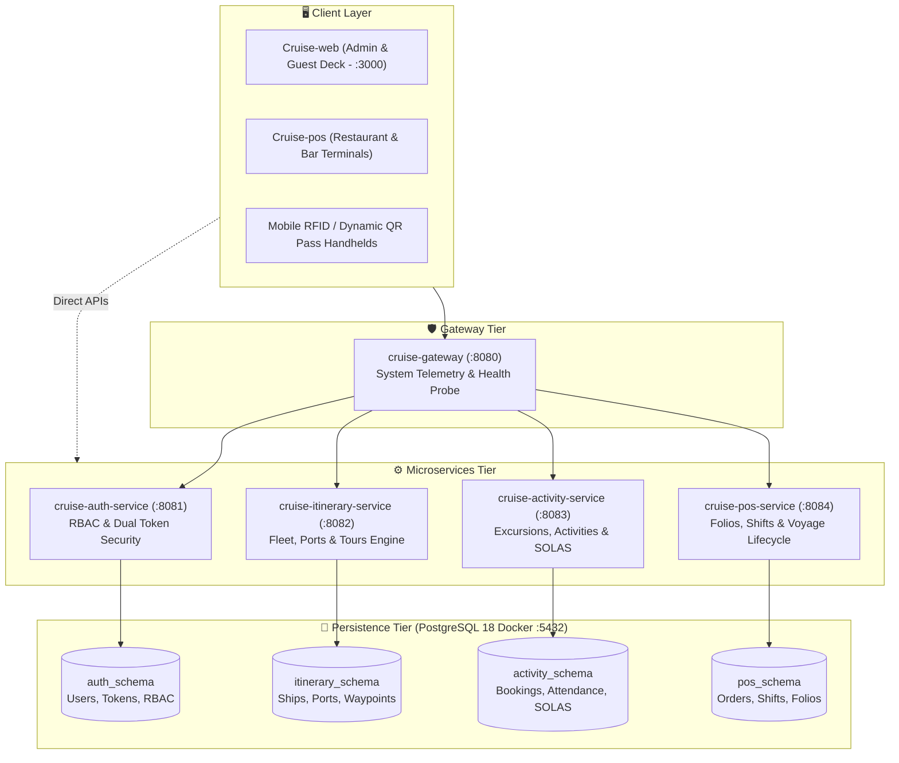

<div align="center">


<br />

# 🚢 CRUISE-API
### Enterprise Microservices Architecture & Maritime Fleet Operations Engine

**An open enterprise backend ecosystem engineered for luxury cruise fleets.**  
Orchestrating high-throughput safety-critical maritime operations, real-time SOLAS all-aboard watchdog, offline-resilient POS accounting, dynamic QR shore excursion check-in, and distributed microservices topology.

<br />

<p align="center">
  <a href="https://www.oracle.com/java/">
    
  </a>
  <a href="https://spring.io/projects/spring-boot">
    
  </a>
  <a href="https://www.postgresql.org/">
    
  </a>
  <a href="https://www.docker.com/">
    
  </a>
  <a href="https://www.postman.com/">
    
  </a>
  <a href="https://sonarcloud.io/project/overview?id=Cruise-JavaCLass_Cruise-api">
    
  </a>
  <a href="https://github.com/Cruise-JavaCLass/Cruise-api/blob/main/LICENSE">
    
  </a>
</p>

</div>

---

## 🏛️ Executive Summary & Microservices Topology

`Cruise-api` is designed as a modular, resilient multi-module Maven microservices architecture. Each bounded context is isolated with its dedicated database schema, preventing domain coupling while allowing independent scaling and failover.

<table>
  <thead>
    <tr>
      <th>Module</th>
      <th>Port</th>
      <th>Database Schema</th>
      <th>Core Maritime Responsibilities</th>
    </tr>
  </thead>
  <tbody>
    <tr>
      <td><b><code>cruise-gateway</code></b></td>
      <td><code>8080</code></td>
      <td><i>None</i></td>
      <td>
        • Central API entry point & reverse-routing coordinator.<br />
        • High-speed health probes (<code>/ping</code>, <code>/info</code>, <code>/health</code>).<br />
        • JVM memory telemetry & global CORS resolution.
      </td>
    </tr>
    <tr>
      <td><b><code>cruise-auth-service</code></b></td>
      <td><code>8081</code></td>
      <td><code>auth_schema</code></td>
      <td>
        • Dual-token lifecycle (HMAC-SHA256 Access Token + Rotating Refresh Token).<br />
        • Role-Based Access Control (RBAC) across 8 nautical officer roles.<br />
        • RFC 7662 Token Introspection & active blacklist revocation.
      </td>
    </tr>
    <tr>
      <td><b><code>cruise-itinerary-service</code></b></td>
      <td><code>8082</code></td>
      <td><code>itinerary_schema</code></td>
      <td>
        • Fleet management (vessel dimensions, passenger capacity, cruising specs).<br />
        • Ports of call catalog & docking berth coordination.<br />
        • Master cruise tours, daily sailing schedules & maritime cabotage policies.
      </td>
    </tr>
    <tr>
      <td><b><code>cruise-activity-service</code></b></td>
      <td><code>8083</code></td>
      <td><code>activity_schema</code></td>
      <td>
        • Onboard entertainment, gala dinners & recreation scheduling.<br />
        • Shore excursions (capacity locking, pricing, guide assignments).<br />
        • <b>SOLAS Compliance:</b> All-Aboard Watchdog countdown & Muster Station drills.<br />
        • High-security dynamic QR pass verification (60s TTL).
      </td>
    </tr>
    <tr>
      <td><b><code>cruise-pos-service</code></b></td>
      <td><code>8084</code></td>
      <td><code>pos_schema</code></td>
      <td>
        • Retail menu catalogs (dining, bars, spa, ship boutiques).<br />
        • Cashier shift lifecycle, cash drops & mid-day X-Reports.<br />
        • Real-time passenger folio billing, cabin stateroom charging & disputes.<br />
        • Voyage Global State Machine (<code>EMBARKATION</code>, <code>AT_SEA</code>, <code>CLOSED</code>).
      </td>
    </tr>
    <tr>
      <td><b><code>cruise-common</code></b></td>
      <td><i>Shared</i></td>
      <td><i>N/A</i></td>
      <td>
        • Universal DTO contracts (<code>ApiResponse&lt;T&gt;</code>, pagination projections).<br />
        • Global error codes, security annotations & domain enumerations.
      </td>
    </tr>
  </tbody>
</table>

---

## 📐 System Architecture Diagram



---

## ⚡ Quickstart & 1-Click Launch Guide

### Prerequisites
- **JDK 21 LTS** installed (`java -version` returns Java 21)
- **Docker Desktop** running (for PostgreSQL 18 container)
- **Git** & **Postman Desktop** (optional, for visual API execution)

### Option 1: 1-Click Windows Automation (Recommended)
You can launch the entire ecosystem in 3 seconds using the pre-configured root launcher scripts:

```cmd
:: 1. Launch PostgreSQL and all 5 Microservices in dedicated consoles
run-all-services.bat

:: 2. Stop all running services cleanly when finished
stop-all-services.bat
```

> [!TIP]
> `run-all-services.bat` is completely **idempotent**: it automatically purges any stale processes lingering on ports `8080-8084`, starts the Docker Postgres container, injects `CRUISE_QR_SECRET`, and boots all 5 services cleanly.

---

### Option 2: Manual Terminal Execution

#### 1. Start the Multi-Schema Database
```bash
docker compose up -d
```
*Creates the container `cruise-postgres` and initializes schemas: `auth_schema`, `itinerary_schema`, `activity_schema`, `pos_schema`.*

#### 2. Compile & Install Shared Libraries
```bash
./mvnw -pl cruise-common install -DskipTests
```

#### 3. Run Individual Microservices
Open separate terminals for each desired service:
```bash
# Gateway (Port 8080)
./mvnw -pl cruise-gateway spring-boot:run

# Authentication (Port 8081)
./mvnw -pl cruise-auth-service spring-boot:run

# Itinerary & Fleet (Port 8082)
./mvnw -pl cruise-itinerary-service spring-boot:run

# Activities & SOLAS (Port 8083)
./mvnw -pl cruise-activity-service spring-boot:run

# POS & Folio (Port 8084)
./mvnw -pl cruise-pos-service spring-boot:run
```

---

## 📬 Automated Postman Enterprise Test Suite

The project includes a comprehensive, production-grade Postman collection and environment suite located in [`docs/postman/`](./docs/postman/):

- 📄 **Collection:** [`Cruise_Management_System_v1.0.0.postman_collection.json`](./docs/postman/Cruise_Management_System_v1.0.0.postman_collection.json) *(37 comprehensive endpoints with automated assertions)*
- 📄 **Environment:** [`Cruise_Local.postman_environment.json`](./docs/postman/Cruise_Local.postman_environment.json) *(Pre-mapped hosts and auto-syncing JWT token)*

### Suite Structure:
```text
Cruise Management System v1.0.0 (Enterprise Full Suite)
├── 00 - Gateway & Monitoring (cruise-gateway:8080)
│   ├── Ping Service [GET]
│   ├── System Information [GET]
│   └── Health & JVM Stats [GET]
├── 01 - Authentication & User Security (cruise-auth-service:8081)
│   ├── Auth Health Check [GET]
│   ├── Admin Login & Auto-Token Capture [POST]  --> (Auto-saves {{jwt_token}})
│   ├── Get Current User Profile (/me) [GET]
│   ├── Token Verification (RFC 7662) [POST]
│   ├── Token Refresh Rotation [POST]
│   ├── Verify User Password [POST]
│   ├── Create New Staff User [POST]
│   ├── Get User By Username [GET]
│   └── Logout & Revoke Token [POST]
├── 02 - Fleet & Itinerary Operations (cruise-itinerary-service:8082)
│   ├── List Cruise Ships [GET]
│   ├── List Ports of Call [GET]
│   ├── List Cruise Tours [GET]
│   ├── Get Daily Itinerary for Tour #1 [GET]
│   ├── Get Tour Stops for Tour #1 [GET]
│   └── Cruise Maritime Area Policies [GET]
├── 03 - Shore Excursions & Activities (cruise-activity-service:8083)
│   ├── Activity Service Health [GET]
│   ├── List Onboard Activities [GET]
│   ├── Create New Activity [POST]
│   ├── List Shore Excursions [GET]
│   ├── Passenger Portal Catalog [GET]
│   ├── Operations Live Dashboard [GET]
│   ├── SOLAS All-Aboard Watchdog [GET]
│   ├── SOLAS Muster Station Readiness [GET]
│   ├── RFID Cards Management [GET]
│   └── Passenger Notifications [GET]
└── 04 - POS, Folios & Voyage Lifecycle (cruise-pos-service:8084)
    ├── POS Menu & Service Catalog [GET]
    ├── Active POS Shifts [GET]
    ├── Current Shift X-Report [GET]
    ├── List Cash Drops [GET]
    ├── Passenger Folio Accounts [GET]
    ├── POS Terminals Admin Registry [GET]
    ├── Cabin Billing Summaries [GET]
    ├── Dispute Records [GET]
    └── Voyage Phase Control Center [GET]
```

### Running Automated Regression via Newman CLI:
```bash
npx --yes newman run docs/postman/Cruise_Management_System_v1.0.0.postman_collection.json \
  -e docs/postman/Cruise_Local.postman_environment.json \
  --reporters cli
```

---

## ⚓ Maritime Domain & Safety Specifications

### 1. SOLAS All-Aboard Watchdog & Muster Drills
In compliance with the **International Convention for the Safety of Life at Sea (SOLAS Chapter III, Regulation 19)**:
- `SolasMusterEmergencyController`: Enforces compulsory passenger lifeboat drill check-ins before vessel departure.
- `AllAboardWatchdogController`: Real-time countdown tracking shore excursion participants to prevent leaving guests stranded in foreign ports of call.

### 2. High-Entropy Dynamic QR Passes (HMAC-SHA256)
- QR passes issued to guests for excursion boarding feature a strict **60-second Time-To-Live (TTL)** and cryptographic signature to eliminate screenshot sharing, ticket fraud, and unauthorized boarding.

### 3. Voyage Global Lifecycle State Machine
Vessel operational phases are locked through transactional state transitions:
$$\text{SCHEDULED} \longrightarrow \text{BOARDING} \longrightarrow \text{DEPARTED} \longrightarrow \text{AT\_SEA} \longrightarrow \text{PORT\_CALL} \longrightarrow \text{DISEMBARKING} \longrightarrow \text{CLOSED}$$
Transactions, folio postings, and retail purchases are restricted based on the current active phase.

---

## 🧪 Testing & Quality Assurance

Each microservice is backed by comprehensive Unit, Integration, and Mockito tests ensuring $\ge 80\%$ line and branch coverage:

```bash
# Run unit and integration tests across all microservices
./mvnw test -q

# Run targeted test for specific service
./mvnw test -pl cruise-auth-service -Dtest=AuthServiceTest -q

# Run SonarCloud code quality scanner
./mvnw clean verify sonar:sonar
```

---

## 📄 License & Organization

This repository is maintained by the **Cruise Hospitality Technology Engineering Team** under the [MIT License](./LICENSE).  
For frontend web applications and POS tablet clients, see [`Cruise-web`](https://github.com/Cruise-JavaCLass/Cruise-web) and [`Cruise-pos`](https://github.com/Cruise-JavaCLass/Cruise-pos).
